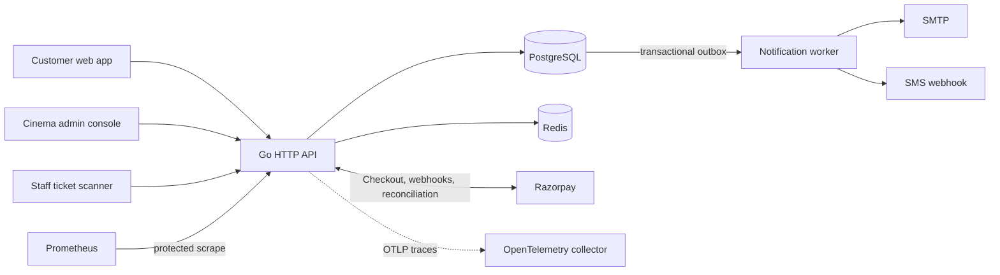

# Cinema Ticket Booking

[](https://github.com/superb-striker/cinema-ticket-booking/actions/workflows/ci.yml)


A cinema booking application built with Go, PostgreSQL, and Redis. Customers can discover screenings, select seats, pay through Razorpay Checkout, manage bookings, and present QR tickets. Cinema operators get an administration console for managing their catalog, screenings, pricing, seat blocks, bookings, refunds, and reports.

The project includes operational foundations for deployment: checked configuration, secure HTTP defaults, structured logs, metrics, optional OpenTelemetry traces, migrations, container hardening, automated browser workflows, CI, and Kubernetes examples.

---

## Features

- **Screening discovery** — Search by title, cinema, city, date, language, and format.
- **Live seat availability** — Accessible seat maps receive updates over server-sent events.
- **Safe reservations** — Redis holds seats with a TTL; PostgreSQL constraints protect inventory when checkout starts.
- **Razorpay payments** — Idempotent order creation, signed callback verification, captured-payment webhooks, reconciliation, and retryable refunds. Payment methods shown at checkout depend on the Razorpay account and dashboard configuration.
- **Customer accounts** — Registration, secure cookie sessions, logout, password reset, optional Google login, email verification, and phone OTP verification.
- **Bookings and tickets** — Booking history, policy-based cancellation, printable HTML tickets with signed QR codes, and single-admission server-side scanning.
- **Cinema administration** — Manage movies, cinemas, auditoriums and layouts, shows, pricing tiers, seat blocks, promotions, customer support, refunds, and reports.
- **Notifications** — Transactional outbox with retries for email and optional SMS delivery.
- **Web experience** — Responsive customer, administration, and staff scanner pages; accessible seat controls; offline browsing of cached public catalog data.
- **Operations** — Health and readiness endpoints, authenticated Prometheus metrics, optional OTLP tracing, request IDs, panic recovery, rate limits, and graceful shutdown.

---

## Architecture



### Booking and inventory

Redis coordinates short-lived seat holds and distributed rate limits. At checkout, PostgreSQL becomes authoritative: a partial unique index prevents concurrent live orders from claiming the same screening seat. The `screening_inventory` view exposes confirmed seat counts and seat IDs for cinema operations and reporting. Redis can expire or lose a temporary hold; it cannot confirm a booking.

Payment confirmation is asynchronous. The backend verifies the browser callback's Razorpay signature, while a validated `payment.captured` webhook or the reconciliation worker confirms the order and seats. If payment arrives after the order reservation expires, the system queues a refund instead of confirming already released inventory.

---

## Quick start

### Requirements

- Docker with the Compose plugin
- Razorpay test-mode API credentials for completing checkout tests

### Run locally

```sh
git clone https://github.com/superb-striker/cinema-ticket-booking.git
cd cinema-ticket-booking
cp .env.example .env
```

Add your Razorpay test key ID, key secret, and a separate webhook secret to `.env`. If you are not enabling Google login, clear the example callback value so all three Google settings are empty:

```dotenv
GOOGLE_CLIENT_ID=
GOOGLE_CLIENT_SECRET=
GOOGLE_REDIRECT_URL=
```

To bootstrap an administrator, set `ADMIN_EMAILS` to the email address you will register with. Then start the application:

```sh
docker compose up --build -d
docker compose ps
```

Open [http://localhost:8080](http://localhost:8080), register an account, choose a screening, and select seats. Compose starts PostgreSQL, Redis, and Jaeger, runs database migrations, then starts the API. The local database and Redis data are kept in Docker volumes; Jaeger uses ephemeral in-memory trace storage.

For local development, notifications use `NOTIFICATION_LOG_ONLY=true`; password reset and booking messages appear in the app logs:

```sh
docker compose logs -f app
```

Stop the services while preserving data with `docker compose down`. Redis Commander is available only through the local `debug` profile. Set non-default `REDIS_COMMANDER_USER` and `REDIS_COMMANDER_PASSWORD` before starting it with `docker compose --profile debug up -d redis-commander`.

### Razorpay webhook testing

Razorpay must reach the webhook through a public HTTPS URL. For local testing, expose port 8080 through an HTTPS tunnel and configure the resulting URL with the `payment.captured` event:

```text
https://<your-public-test-host>/api/v1/webhooks/razorpay
```

Use the same webhook secret in the Razorpay dashboard and `RAZORPAY_WEBHOOK_SECRET`. Payment methods shown in Checkout are controlled by Razorpay account configuration.

For a successful test payment, check that Razorpay reports a captured payment, the local order becomes `confirmed`, and the selected seats appear in `screening_inventory.confirmed_seats`. Also check webhook delivery separately: reconciliation can confirm an order even when webhook delivery fails. Before deployment, exercise failed payments, recovery with the webhook disabled, and refund handling for payments captured after reservation expiry.

---

## Applications and API docs

- Customer booking app: `/`
- Cinema administration console: `/admin.html`
- Staff scanner: `/scanner.html`
- Searchable API reference: `/docs` when the application is running
- OpenAPI 3.1 contract: [`static/openapi.yaml`](static/openapi.yaml), served at `/openapi.yaml`
- API compatibility policy: [`docs/api-versioning.md`](docs/api-versioning.md)

All application API routes use the `/api/v1` prefix. Unknown API versions return a machine-readable error instead of the single-page app.

### Main customer flow

1. Register or log in using `/api/v1/auth/register` or `/api/v1/auth/login`.
2. Search screenings with `GET /api/v1/screenings`; filters include `q`, `cinema_id`, `city`, `date`, `language`, and `format`.
3. Load seats at `GET /api/v1/screenings/{screeningID}/seats` or subscribe to `GET /api/v1/screenings/{screeningID}/seat-events` for updates.
4. Hold selected seats with `POST /api/v1/screenings/{screeningID}/holds` and `{"seat_ids":["A1","A2"]}`.
5. Create checkout with `POST /api/v1/screenings/{screeningID}/holds/{holdID}/checkout` and a unique `Idempotency-Key` header.
6. Complete payment in Razorpay Checkout and post its signed callback to `POST /api/v1/orders/{orderID}/verify-payment`.
7. Read `GET /api/v1/orders/{orderID}` until the webhook or reconciliation worker confirms the order.
8. View bookings at `GET /api/v1/bookings`; download a ticket or request cancellation from the booking routes.

The browser callback alone does not confirm a booking. The backend confirms seats after validating Razorpay's captured-payment event or verifying the capture through reconciliation.

### Staff ticket scanning

The scanner page uses the server-side single-admission validation API. A scanner request includes the shared deployment key:

```http
POST /api/v1/tickets/validate
X-Scanner-Key: <SCANNER_API_KEY>
Content-Type: application/json

{"code":"<scanned QR contents>"}
```

The QR contains an HMAC-signed booking ID. The backend validates the signature and booking state and records the first admission atomically. Keep the scanner key secret; larger deployments should use per-staff or per-device credentials.

---

## Configuration and integrations

The environment variable reference is in [`.env.example`](.env.example). Local Compose supplies development defaults. Production configuration is validated at startup, including payment credentials, secure cookies, HTTPS public URLs, and required secrets. Compose passes only the variables declared in its service environment; additional options must also be passed to the container through your deployment configuration.

- **Google login:** set `GOOGLE_CLIENT_ID`, `GOOGLE_CLIENT_SECRET`, and `GOOGLE_REDIRECT_URL` together. Register the callback URL exactly with Google.
- **Email:** set SMTP host, credentials, and sender, then set `NOTIFICATION_LOG_ONLY=false`.
- **SMS:** configure `SMS_WEBHOOK_URL` and optionally `SMS_API_TOKEN`. The adapter sends `{"to":"...","message":"..."}` with an optional bearer token.
- **Redis TLS:** production requires `REDIS_TLS_ENABLED=true` and authentication. Private CA and mTLS options are documented in the env file and [Redis operations guide](docs/redis-operations.md).
- **Tracing:** set `OTEL_TRACING_ENABLED=true` and an OTLP endpoint. Use `OTEL_TRACE_SAMPLE_RATIO` to control sampling.

Email and phone ownership are verified before booking and refund notifications are sent. Changing a phone number clears its previous verification state.

---

## Development

### Local tracing

Compose includes [Jaeger 2.22](https://www.jaegertracing.io/docs/2.22/getting-started/) for viewing HTTP server traces. Set these in `.env`:

```dotenv
OTEL_TRACING_ENABLED=true
OTEL_SERVICE_NAME=cinema-api
OTEL_TRACE_SAMPLE_RATIO=1.0
OTEL_EXPORTER_OTLP_ENDPOINT=http://jaeger:4318
OTEL_EXPORTER_OTLP_HEADERS=
```

Run `docker compose up -d`, browse screenings or sign in, then open
[Jaeger](http://localhost:16686) and search for service `cinema-api`.
Allow a few seconds for export. Health and metrics requests are excluded from tracing.
The UI is bound to localhost; ingestion stays on the Docker network. This local
Jaeger uses in-memory storage, so restarting it clears traces. Database, Redis,
and payment-provider calls do not currently have their own spans.

### Checks

Run the Go suite from the repository root:

```sh
go test ./...
go test -race ./...
go vet ./...
```

Redis-dependent tests use miniredis; HTTP provider tests use local test servers. Start the Compose stack for manual end-to-end payment and webhook testing.

CI also checks formatting, `go vet`, unit and race tests, Staticcheck, Go vulnerability findings, the OpenAPI contract, the production container image, and headless Chrome workflows. The container job fails on fixable high- or critical-severity findings, while the browser job uploads screenshots, console logs, and JUnit reports when a test fails. Dependabot checks Go modules, GitHub Actions, and Docker images weekly.

Run the OpenAPI linter locally with:

```sh
npx --yes @redocly/cli@2.64.1 lint static/openapi.yaml
```

### Browser workflow tests

The Java 17 Selenium suite exercises customer registration and login, screening and seat flows, booking history, authorization boundaries, and ticket scanning against an isolated Compose stack. With the application ready at `http://localhost:8080`, run:

```sh
cd qa/selenium
mvn test \
  -DbaseUrl=http://localhost:8080 \
  -Dheadless=true \
  -DscannerKey=local-scanner-api-key-change-me
```

Local runs require Java 17, Maven, and Chrome or Chromium. CI uses the Google Chrome installation on the GitHub-hosted Ubuntu runner. See the [Selenium suite guide](qa/selenium/README.md) for browser overrides, database fixture settings, Selenium Grid usage, and the suite's payment-testing limits.

---

## Production deployment and operations

The repository includes a non-root distroless Docker image, a hardened Compose definition for external data services, and Kubernetes manifests. These are starting points; production needs environment-specific secrets, managed PostgreSQL and Redis, provider credentials, DNS/TLS, and network rules.

- [Production container and Compose](docs/production-container.md)
- [Kubernetes deployment and rollback](docs/deployment.md)
- [Database migrations, backup, and recovery](docs/database-operations.md)
- [Redis security, persistence, and recovery](docs/redis-operations.md)
- [API compatibility and versioning](docs/api-versioning.md)

Health endpoints are `/health/live` and `/health/ready`. When enabled, `/metrics` requires a bearer token in production. Tracing exports sampled HTTP spans using OTLP. Before launch, place the service behind HTTPS, restrict access to data services, protect secrets with a secret manager, and practice database restore and payment reconciliation procedures.

---

## Security notes

- Production requires HTTPS, secure cookies, explicit CORS origins, and strong signing, scanner, payment, and metrics secrets.
- Registration, login, password recovery, seat holds, checkout, and ticket scanning have rate limits.
- Forwarded client IP and HTTPS headers are trusted only from networks listed in `TRUSTED_PROXY_CIDRS`.
- Razorpay webhooks are signature checked and deduplicated; payment amount and currency are verified before confirmation.
- Redis stores temporary holds, not confirmed inventory. PostgreSQL constraints and transactions protect booking state.
- Never commit `.env`, production credentials, signing keys, or real payment secrets.

Report suspected vulnerabilities privately to the repository maintainer rather than publishing exploit details.
